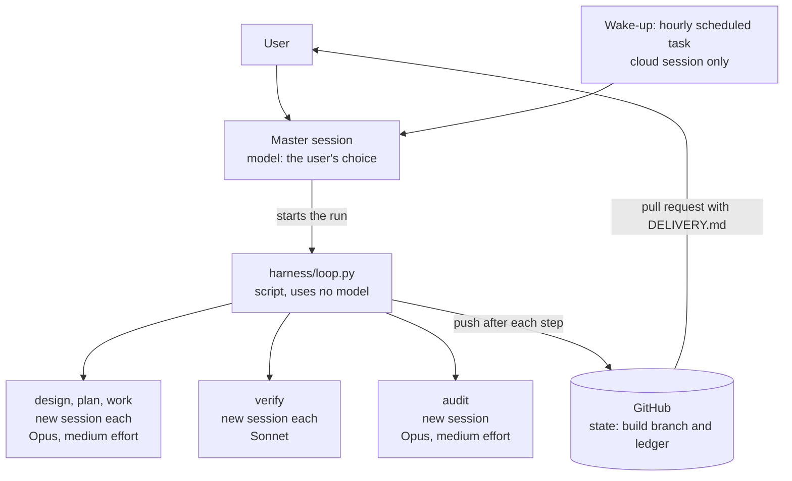

# Architecture

This harness turns an approved spec into a finished, checked project with no person in the loop. A
script coordinates the run. Each step of the run is a new Claude Code session that knows only its own
step. Scripts, not the model, decide what is done. All state is in git and goes to GitHub after each
step, so any new session can continue the run.



## The parts

| Part | Job |
| --- | --- |
| Master session | The Claude Code session the user talks to. It runs the `intake` skill (interview, spec, setup), starts the run, and helps the user answer a stop. Its rules tell it not to do the build work itself. Its rules are section B of `CLAUDE.md`. |
| `.claude/skills/intake/SKILL.md` | The interview, the spec, the setup (environment, boundary, tools, secrets, guards, wake-up) and the launch. Also the change mode for a changed spec. |
| `harness/spec.py` | Checks the spec (`check`), renders it (`render`), records the approval as a hash (`approve`), says where each secret is kept (`secrets`), writes `spec/SETUP.md` (`setup`), and records the user's guards (`guard`). |
| `harness/loop.py` | The coordinator. A plain Python script: `run`, `status`, `retry <id>`. It starts each run session, checks the result with scripts, and records it. |
| `harness/run.sh` | Runs the preflight, then the loop: in tmux in a terminal, or in the foreground with `--foreground`. `bash harness/run.sh status` prints the status. |
| `harness/prompts/` | The brief of each step: `design.md`, `plan.md`, `work.md`, `verify.md`, `audit.md`. |
| `CLAUDE.md` | The rules. Section A and "Rules for run sessions" are for run sessions; section B is for the master session. |
| `harness/run-settings.json` | The permissions of each run session: allow list, deny list, and the command guard hook. |
| `harness/guard.sh` | The command guard: a hook that checks each shell command of a run session before it runs. See [SECURITY.md](SECURITY.md). |
| `harness/mcp.json` | The only tool server a run session sees: the Playwright browser tool (`@playwright/mcp`, version 0.0.86, headless). |
| `checks/run_gates.sh` | The gates. It runs `check_scope.sh` (secrets and file size), `check_progress.sh` (ledger rules), `check_protected.sh` (harness unchanged on a build branch), `check_project.sh` (lint, tests, build of the project), and each script in `checks/guards/`. |
| `harness/hooks/pre-push`, `harness/install-hooks.sh` | A git hook that runs the gates before a push by hand. The preflight installs it. |
| `.github/workflows/gates.yml` | CI: the self-test and the gates on each push and pull request. |
| `harness/tests/selftest.sh`, `harness/tests/mock_claude` | The self-test and the fake model it uses. |
| `harness/preflight.sh` | The checks before a run, with one real run session. |
| `.claude/agents/scout.md`, `critic.md` | Helper subagents of the run sessions (Sonnet): a read-only explorer and a read-only reviewer. |

Files of a project:

| Path | What it is | Written by |
| --- | --- | --- |
| `spec/BRIEF.md` | The user's first description, word for word | intake |
| `spec/requirements.json` | The spec, the only source of truth: user stories, EARS requirements, examples, personas, secrets by name | intake, approved by the user |
| `spec/REQUIREMENTS.md`, `.env.example`, `spec/APPROVED` | Readable copy, secret names, approval hash | `spec.py approve` |
| `spec/SETUP.md` | Environment, boundary, `sudo`, wake-up, where each secret is kept, the guards | `spec.py setup` and `spec.py guard` |
| `spec/DESIGN.md`, `plan/milestones.json`, `init.sh` | Architecture, milestones, install script | design session |
| `plan/*.jsonl`, `checks/tasks/`, `checks/acceptance/` | Tasks, and the checks that prove them | plan sessions |
| `checks/guards/` | The user's guards that a script can check | intake setup |
| `ledger.jsonl`, `PROGRESS.md`, `DELIVERY.md` | State of each item, step log, delivery report | `loop.py` only |
| `notes/decisions.md` | One line for each minor decision of a run session, and the user's answers | run sessions, master session |

## The flow of a run

The loop works on its own branch `build/<project>`. It never works on `main`. The spec, the setup and
the guards live on `main`; the result comes back to `main` as a pull request that the user merges.

1. **Design** (once). Writes `spec/DESIGN.md`, `plan/milestones.json` (each requirement in exactly one
   milestone), `checks/check_project.sh` and `init.sh`.
2. **Plan** (per milestone, when it can start). Splits the milestone into small tasks with one check
   each in `checks/tasks/`, and writes one acceptance check per requirement in `checks/acceptance/`.
   The loop rejects the plan unless each check parses and fails before the work exists.
3. **Work** (one task, one session). Afterwards the loop undoes each change to the spec, the plan, the
   checks, the ledger and the harness.
4. **Check.** The loop runs the task's check and the gates.
5. **Verify.** A new session with no edit tools, which did not do the work, reads the diff and ends
   with `VERDICT: PASS` or `FAIL`. The loop discards any change it makes.
6. **Close.** When the tasks of a milestone are done, the acceptance checks of its requirements must
   pass. If not, the milestone is planned again (up to 3 rounds).
7. **Audit.** When each milestone is closed, the loop runs each acceptance check and the gates again.
   Then an auditor session uses the product as a user would and compares it with the spec and the
   personas. Each gap becomes a fix milestone. Up to 3 audits.
8. **Deliver.** The loop writes `DELIVERY.md` (each requirement, its acceptance check, the result of a
   new run of it, the gates, the audit), commits it, pushes, puts it in the pull request and marks the
   pull request ready.

## How a script decides what is done

A run session does not decide success. A task is done only when its check passes, `checks/run_gates.sh`
passes, and the verify session says PASS. `ledger.jsonl` holds the state of each item (`todo`, `doing`,
`blocked`, `done`), its attempts and its question. `checks/check_progress.sh` enforces its rules: no
task is done without a commit and a passed check, no item is blocked without a reason, and
`PROGRESS.md` is append-only. Checks are written before the work and must fail first. The loop undoes a
change of a work session to a check.

## Blocked items and `depends_on`

A failed task is tried 3 times in total, each time with the text of the last failure, then it is
`blocked`. A work session that needs a decision it may not make (money, a new account, a radical change
of architecture) changes nothing and ends with two lines, `QUESTION: ...` and `RECOMMENDED: ...`; its
task is blocked at once. Run sessions decide each minor item themselves and log it in
`notes/decisions.md`.

A milestone is blocked when its plan is rejected 3 times, when its acceptance checks still fail after
3 planning rounds, or when only blocked tasks, and tasks that depend on them, are left in it. A blocked
item does not stop the run: the loop takes the next item that does not depend on a blocked item.
Tasks have a `depends_on` list. A milestone has an optional `depends_on` list of earlier milestones;
with no key it depends on the milestone before it, and `[]` means independent.

## The stop report, `status` and `retry`

The run stops when no item is left that can run. It does not deliver then. It prints a stop report and
writes it to `.harness-run/last-stop.txt`. The report has one `QUESTION:` and one `RECOMMENDED:` answer
for each blocked task, and for the design or a milestone that the loop blocked itself. A milestone
blocked by its tasks carries their questions. The report also lists what each other open item waits on.

`python3 harness/loop.py status` prints the ledger summary, the last stop, and a line `run:`:

| `run:` | Meaning |
| --- | --- |
| `active in this clone` | A loop holds the run lock. |
| `DELIVERED` | `DELIVERY.md` was written and committed. |
| `stopped, needs the user` | The last stop needs a person. |
| `not active` | No run is active and no person is needed: start the run again. |

The run never retries a blocked item by itself. After the user answers, the master session writes the
answer to `notes/decisions.md` (or changes the spec with the `intake` skill), runs
`python3 harness/loop.py retry <id>` for each answered item, and starts the run once. `retry` refuses
while a run is active.

Each stop that the loop makes itself prints the reason and writes `.harness-run/last-stop.txt`. With
`notify-send`, it shows a desktop notification. With `gh` and a pushed branch, a stop with an exit code
other than 0 adds the report as a comment on the pull request. A delivery adds no such comment; it marks
the pull request ready. Ctrl+C is such a stop. A stop by SIGTERM or SIGHUP, a machine that goes
down, or a crash of the loop writes none of these. The loop's messages call a step a "leg".

| Stop | Exit code | Needs the user |
| --- | --- | --- |
| Delivered | 0 | no |
| No item left that can run (blocked items) | 3 | yes |
| 5 steps in a row with no progress | 3 | yes |
| The audit still finds gaps after 3 audits | 3 | yes |
| Claude sign-in failed | 3 | yes |
| A session failed, and retries did not help | 3 | yes |
| Step budget (`--max-legs`, default 400) or time budget (`--max-hours`, default 24) | 3 | no, `RESUMABLE` |
| A usage limit that did not clear | 3 | no, `RESUMABLE` |
| Ctrl+C | 3 | no, `RESUMABLE` |
| Cannot start (spec not approved or changed, uncommitted changes, another loop runs) | 1 | yes |

## Resume from a new clone

When the repo has a remote and `--no-push` is not set, the loop pushes the run branch after each step.
A failed push gives a warning; the next push carries the commits. `run`, `status` and `retry` fetch the
run branch, switch to it (also from `main` or a session branch), and fast-forward the local branch. If
the local and the remote branch have diverged, `run` and `retry` stop with a message; they never merge
or force. So a new session in a new clone continues where the last push left it.

On a `build/` branch, `run` first ends a run session that a killed loop left running (its process ID is
in `.harness-run/session.pid`, and the loop ends it only if its command line holds this clone's settings
path), then discards uncommitted changes of a step that was cut off, and lists them. On another branch it
refuses uncommitted changes. `status` does not switch the branch when the tree has uncommitted changes;
it prints a note and stays.

The loop's own pushes skip the pre-push hook (`--no-verify`), because a state in the middle of a task can
fail a gate. The loop runs the gates itself before it accepts work, and CI runs them on each push.

With `gh`, the first push opens a draft pull request. If `gh` is missing or fails, the run goes on
without it, and `DELIVERY.md` is still committed and pushed.

## Usage limits and provider errors

A provider error (5xx, timeout, overload) is retried with pauses and does not count as a failed attempt.
A usage limit (for example "You've hit your session limit · resets 3:45pm") is waited out: the loop tries
again every 15 minutes (`HARNESS_LIMIT_POLL`, in seconds) for up to 8 hours (`HARNESS_LIMIT_HOURS`).
The wait does not count as a failed attempt and does not use the time budget.

## The run in a cloud session

A cloud machine stops a process that the session does not track a few minutes after the session's turn
ends (measured once: between 3 min 44 s and 5 min 46 s). So tmux does not keep a run alive there. The
master session starts the run as a tracked background command of its shell tool:

```bash
bash harness/run.sh --foreground --max-hours 1
```

This kept the machine alive for the 12 minutes measured. The loop stops itself between steps after
about one hour, which is before the 2-hour limit of a background command, and the master session starts
it again. The safety net is the wake-up: an hourly scheduled task named `build wake-up` that fires into
the same session. It runs `status` and acts on the `run:` line: `active`, nothing; `not active`, start
the run again; `DELIVERED` or `stopped, needs the user`, delete the task and tell the user. A wake-up
can arrive on a new machine; the run continues from the last pushed state. The intake creates the task
only with the user's approval and only when the session has a tool that creates a scheduled task that
fires into the same session. Otherwise the wake-up is `none`: when the machine is replaced or the command reaches its time
limit, the run waits for a message from the user.

The documentation of Claude Code cloud environments states that the proxy rejects `gh pr`. When `gh`
fails, the master session opens the pull request with its own GitHub tool.

In a Linux terminal, `bash harness/run.sh` runs the loop in tmux, which survives a closed terminal.

## Models and effort

The loop passes `--model` and `--effort` to each run session. Defaults: `opus` for design, plan, work and
audit; `sonnet` for verify; `medium` effort for each. `HARNESS_MODEL_<STEP>` and `HARNESS_EFFORT_<STEP>`
(`STEP` is `DESIGN`, `PLAN`, `WORK`, `VERIFY` or `AUDIT`) change one step. `HARNESS_MODEL` and
`HARNESS_EFFORT` change each step that has no variable of its own. An empty value leaves the choice to
Claude Code. Claude Code's own variable `CLAUDE_CODE_EFFORT_LEVEL`, if it is set, overrides the effort
that the loop passes. The helper subagents use `sonnet`. The master session uses the model the user
chose.

## The self-test and the preflight

`bash harness/tests/selftest.sh` uses no model and no network. It copies the harness into a temporary
repo, approves a spec of two small requirements, and runs the real loop against a fake model
(`harness/tests/mock_claude`) and a fake `gh`. It takes about 40 seconds. CI runs it on each push. It
proves that:

- the loop delivers: design, plan, work, verify, an audit gap, a fix milestone, a second audit,
  `DELIVERY.md` with 2 of 2 requirements, the pull request marked ready;
- the loop survives bad behaviour of the model: a provider error is retried; a usage limit is waited out
  and does not count as an attempt; edits of a work session to the ledger, a task check and a guard
  script are undone; an edit of a plan session to a frozen acceptance check is undone;
- a run stopped by its budget continues in a new clone of its remote, on a session branch, and does
  nothing twice; a step cut off by the end of its command is discarded;
- a blocked milestone does not stop independent work: the independent milestone is done, the dependent
  one does not start, and the stop report has one question and one recommended answer;
- in a new clone, `status` shows the question, `retry` refuses an item that is not blocked and refuses
  while a run holds the lock, and the run after `retry` delivers, also when `gh` fails and the pre-push
  hook fails;
- a requirement added in change mode is planned, built and delivered; `approve` is refused on a session
  branch; a spec changed after approval stops the next run before it starts;
- each step gets its default model and effort, and the variables change them;
- `spec.py setup` records the wake-up and refuses wrong values; `run.sh --foreground` returns the loop's
  exit code; `status` reports each `run:` state; the next run ends a run session of a killed loop and
  leaves other processes alone.

`bash harness/preflight.sh` runs before each run (`harness/run.sh` calls it). It checks the tools, the
spec and its approval, the secrets, `.env`, `spec/SETUP.md`, the git tree, remote and identity, the
pre-push hook, and the gates. Then it starts one real headless run session with the same settings, hook
and tool server as the loop (the verify model), and proves three facts from the session's own tool
calls and results, not from its words alone:

1. Run sessions load `CLAUDE.md`: the session gives a code word that is only in `CLAUDE.md`, and no tool
   call read it.
2. The command guard blocks: a `git rebase --abort` command is blocked by `harness/guard.sh`, and the
   command after it in the same line did not run.
3. The browser tool works: the session opens a local web page with the Playwright tool and reports a
   random token that is only on that page.

It takes about 20 seconds plus the first download of the browser tool. `bash harness/preflight.sh tools`
runs only the tool check. In the template, before the intake, the spec and secrets lines fail as
expected and the exit code is 1; the four lines under `== claude ==` are still the proof of the three
facts.

## Design decisions

- **A script is the coordinator, not a model.** Order, retries, limits and "done" are rules that a
  script applies the same way each time, with no usage. A model coordinator can drift, forget, or
  declare success. One master session above the script talks to the user.
- **A new session for each step.** A long session loses quality as its context fills, and tends to wrap
  up early. A new session gets only its brief and reads its state from git, so nothing depends on the
  memory of a session, and any step can run on a new machine.
- **A different session verifies.** The session that did the work does not judge it. The verify session
  has no edit tools and did not see the work session. The audit uses the product as a user would.
- **Checks first, and they must fail first.** A check that passes before the work exists proves
  nothing. The loop undoes a change of a work session to a check.
- **State in git, pushed after each step.** The run continues from any clone, on any machine.
- **Blocked items do not stop the run.** The run does all the work it can, then asks each question once,
  with a recommended answer.

The method draws on: Anthropic, "Effective harnesses for long-running agents"
(<https://www.anthropic.com/research/effective-harnesses-for-long-running-agents>): an initializer
session, one feature per session, state in files and git, checks that start failing, end-to-end tests;
Anthropic, "Harness design for long-running apps"
(<https://www.anthropic.com/research/harness-design-long-running-apps>): context resets, a separate
evaluator, handoff through files; loop write-ups on completion decided by checks and attempt caps; and
spec-driven development (GitHub Spec Kit, Kiro), EARS requirements, specification by example, and the
pre-mortem.

## Known limits

The self-test (fake model) and the real preflight are the automated proof. They do not replace a first
run of your own project: watch the first run of a new project.

Limits of the environment:

- A background command of the shell tool has a limit of 2 hours. So a cloud run works in parts of 1 hour,
  and the hourly wake-up starts the next part.
- In a cloud session the `gh pr` commands of the loop can fail. The master session then opens the pull
  request with its own GitHub tool, and a stop that needs you shows in the session.
- The loop opens the pull request against `main`. A base branch `master` needs a change in `harness/loop.py`.
- Windows: use WSL.

Known behaviour:

- A session that fails each retry (for example during a provider outage) stops the run as "needs the
  user". This is the cautious choice.
- `spec.py approve` runs on each `build/` branch, not only the run branch of this spec. The `intake`
  skill guides to the correct branch; the code does not force it.
- The start of a run ends the process in `.harness-run/session.pid` only if its command line holds the
  absolute settings path of this clone.
- `status` does not switch to the run branch while the tree has uncommitted changes.
- A requirement is only as good as its check. A behaviour that no script can observe is not proven; the
  interview moves such items to `human_gates`.
- The run prepares a deploy; it does not deploy, spend money, message people, or merge.
- Each task costs at least two sessions (work and verify). The usage of a run grows with the number of
  tasks.
- At delivery the gates are reported in `DELIVERY.md`; they passed before the audit.
